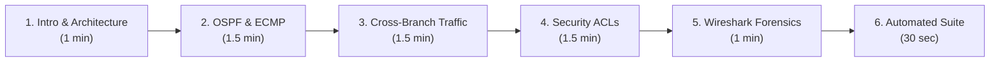

# Multi-Branch Secure Network Lab: Demonstration & Verification Guide

This guide provides a structured, presentation-ready demonstration walkthrough for the **Multi-Branch Enterprise Network**. It covers pre-flight checks, dynamic routing verification (OSPF & ECMP), cross-branch connectivity, Cisco Extended ACL policy enforcement, live traffic generation, and packet-level inspection in Wireshark.

---

## 1. Demo Pre-Flight Checklist

Before presenting, arrange the following windows on your desktop:
1. **Terminal Window:** Rooted at the project directory (`~/Desktop/Multi-Branch Enterprise Network`).
2. **Visual Reference Window:** Cisco Packet Tracer topology (`cisco packet tracer network/Secure_Multi_Branch_Network.pkt`) or the [`screenshots/README.md`](../screenshots/README.md) gallery.
3. **Wireshark Window:** Ready to open or reload the active packet captures (`captures/branch1-all.pcap`).

### 1.1 Check All Active Containers
The topology runs 18 containers: 3 FRRouting routers, 10 departmental client PCs, 2 central infrastructure servers (DHCP & Web/DNS), and 3 continuous packet capture containers.

```bash
docker compose ps
```

**Expected Status:** All 18 containers should display `Up`:
- **Routers:** `lab-hq`, `lab-br1`, `lab-br2`
- **HQ Clients & Servers:** `lab-pc-hq-hr`, `lab-pc-hq-finance`, `lab-pc-hq-it`, `lab-pc-hq-admin`, `lab-srv-dhcp`, `lab-srv-web`
- **Branch 1 Clients:** `lab-pc-br1-hr`, `lab-pc-br1-finance`, `lab-pc-br1-it`
- **Branch 2 Clients:** `lab-pc-br2-hr`, `lab-pc-br2-finance`, `lab-pc-br2-it`
- **Capture Services:** `lab-capture` (BR1), `lab-capture-hq`, `lab-capture-br2`

---

## 2. Recommended 7-Minute Demo Presentation Flow



---

## 3. Step-by-Step Technical Demonstration

### 3.1 Step 1: Dynamic Routing & Equal-Cost Multi-Path (ECMP)
Each router runs FRRouting (`vtysh`) with OSPFv2 in Area 0 over point-to-point `/30` WAN subnets.

#### Check HQ OSPF Neighbors
```bash
docker exec lab-hq vtysh -c "show ip ospf neighbor"
```
- **What to Highlight:** Both remote branch routers (`2.2.2.2` and `3.3.3.3`) in `Full/DR` state. Dead timers count down from 40s and reset every 10s upon receipt of Hellos.

#### Check Full-Mesh WAN Adjacencies
```bash
# Branch 1
docker exec lab-br1 vtysh -c "show ip ospf neighbor"

# Branch 2
docker exec lab-br2 vtysh -c "show ip ospf neighbor"
```
- **What to Highlight:** Branch 1 maintains active peering with HQ (`1.1.1.1`) and Branch 2 (`3.3.3.3`) over the dedicated inter-branch WAN link `10.10.10.8/30`, proving a resilient full-mesh topology.

#### Highlight Equal-Cost Multi-Path (ECMP) on HQ
```bash
docker exec lab-hq vtysh -c "show ip route ospf"
```
- **Key Observation to Highlight:** The route to `10.10.10.8/30` installs **two concurrent next-hops** with identical metric `[110/20]`:
  - `via 10.10.10.2, eth4` (path through Branch 1)
  - `via 10.10.10.6, eth5` (path through Branch 2)  
  *Speaker Note:* *"OSPF installs both paths simultaneously in the kernel FIB for dynamic load sharing and sub-second link failover."*

---

### 3.2 Step 2: Cross-Branch Data Plane & Application Delivery

#### Inter-Branch Cross-Site Connectivity
```bash
# HQ HR (192.168.1.100) -> Branch 2 HR (192.168.21.100)
docker exec lab-pc-hq-hr ping -c 3 192.168.21.100
```
- **What to Highlight:** **0% packet loss** and **`ttl=62`**.
- *Speaker Note:* *"Linux client packets originate with TTL 64. Arriving at TTL 62 mathematically proves the packet crossed exactly two routing hops (HQ Core and Branch 2 Gateway) across the WAN."*

#### Central Corporate Intranet Web Portal Access
```bash
# Fetch corporate portal from Branch 1 HR PC
docker exec lab-pc-br1-hr wget -qO- http://192.168.5.20
```
- **What to Highlight:** HTTP 200 OK returning HTML with `<title>Enterprise Multi-Branch Intranet</title>` and corporate server metadata.

---

### 3.3 Step 3: Zero Trust Security & Cisco Extended ACL Enforcement
The lab implements Cisco Extended Access Control Lists via Linux kernel `iptables` rules on the routers.

#### 1. Baseline: Permitted Departmental Traffic
```bash
# HQ HR (192.168.1.100) -> HQ IT (192.168.3.100)
docker exec lab-pc-hq-hr ping -c 2 192.168.3.100
```
- **Status:** **Permitted** (0% loss) under normal inter-VLAN routing policy.

#### 2. Security Enforcement: Blocked Departmental Access
```bash
# HQ HR (192.168.1.100) -> HQ Finance (192.168.2.100)
docker exec lab-pc-hq-hr ping -c 2 -W 1 192.168.2.100
```
- **Status:** **Blocked** (100% loss) dropped by ACL `BLOCK_HR_TO_FINANCE`.
- Inspect router drop counter:
  ```bash
  docker exec lab-hq iptables -L FORWARD -v -n | grep "192.168.2"
  ```

---

## 4. Live Traffic Generation & Wireshark Visualization

### 4.1 Launching Wireshark

You can view packets using either of two methods:

#### Method A: Open the Active Capture File (Recommended for Demos)
Open the pre-captured router traces in desktop Wireshark:
```bash
open -a Wireshark captures/branch1-all.pcap
```
> [!TIP]
> Whenever you generate new traffic, simply press **`Cmd + R`** (or select **File $\to$ Reload**) in Wireshark to refresh and view newly arrived packets immediately!

#### Method B: Real-Time Live Streaming into Wireshark GUI
To stream packets in real-time into Wireshark as they happen:
```bash
docker exec lab-capture tcpdump -i any -U -w - | "/Applications/Wireshark.app/Contents/MacOS/Wireshark" -k -i -
```

---

### 4.2 Generating Network Traffic

Run the automated traffic generator script to send realistic enterprise traffic bursts across all sites:

```bash
./generate_traffic.sh
```

Alternatively, generate specific traffic flows manually:

| Traffic Type | Command to Trigger | Description |
|---|---|---|
| **HTTP Intranet Request** | `docker exec lab-pc-br1-hr wget -qO- http://192.168.5.20` | Remote branch client pulls portal page from HQ server. |
| **Inter-Branch Ping** | `docker exec lab-pc-hq-hr ping -c 4 192.168.21.100` | ICMP probe routed across point-to-point WAN links. |
| **Blocked ACL Drop** | `docker exec lab-pc-hq-hr ping -c 3 -W 1 192.168.2.100` | Unauthorized cross-department probe dropped at gateway. |

---

### 4.3 The 4 Golden Wireshark Display Filters

Apply these display filters in the green filter bar at the top of Wireshark:

#### 1. HTTP 3-Way Handshake & GET Request
- **Filter:** `http || tcp.port == 80`
- **What to Dissect:**
  - **TCP 3-Way Handshake:** Packet sequence `[SYN]`, `[SYN, ACK]`, `[ACK]`.
  - **HTTP Request:** `GET / HTTP/1.1` from `192.168.11.100` to `192.168.5.20`.
  - **HTTP Response:** `HTTP/1.1 200 OK (text/html)` delivering corporate portal HTML payload.

#### 2. Cross-Branch Multi-Hop Ping
- **Filter:** `icmp`
- **What to Dissect:**
  - `Echo (ping) request` and `Echo (ping) reply` packets.
  - Expand **Internet Protocol Version 4**: Point out `Time to live: 62` (decremented by 2 router hops across the WAN).

#### 3. Security ACL Drop Demonstration
- **Filter:** `ip.dst == 192.168.2.100 || ip.dst == 192.168.12.100`
- **What to Dissect:**
  - Notice that **only incoming Echo Requests** appear on the ingress interface.
  - **There are NO forwarded packets and NO Echo Replies**, proving that the router kernel dropped the unauthorized traffic at layer 3/4.

#### 4. OSPF Dynamic Routing Control Traffic
- **Filter:** `ospf`
- **What to Dissect:**
  - Destination IP: Multicast `224.0.0.5` (All OSPF Routers).
  - Expand **Open Shortest Path First** header:
    - **Router ID:** `3.3.3.3` (Branch 2) or `1.1.1.1` (HQ)
    - **Area ID:** `0.0.0.0 (Backbone)`
    - **Hello Interval:** `10 seconds`
    - **Dead Interval:** `40 seconds`
    - **Network Mask:** `255.255.255.252` (/30 WAN link)

---

## 5. Automated Verification Test Suite

Conclude your demonstration by running the comprehensive automated test suite:

```bash
./test_connectivity.sh
```

**Expected Benchmark Output:**
```
====================================================================
   CONNECTIVITY & SECURITY DEMONSTRATION COMPLETE: ALL TESTS PASSED   
====================================================================
```
Validates:
1. OSPF neighbor full convergence across all 3 routers.
2. Cross-branch multi-host ping matrix.
3. HQ central web server availability.
4. Cisco Extended ACL isolation rules across all sites.
5. Passive Wireshark packet capture file health.

---

## 6. Visual Deliverables & Verification Screenshots

All 10 project verification milestones have been captured at **2x Retina resolution** and documented with full technical descriptions:
- **Visual Gallery:** [`screenshots/README.md`](../screenshots/README.md)
- **Academic Report Checklist:** Section 8 of [`docs/REPORT.md`](REPORT.md#8-academic-submission-screenshot-checklist)

---

## 7. Anticipated Q&A & Technical Defense

| Likely Question | Confident Technical Answer |
|---|---|
| **"Why did you use `/30` subnets on the WAN?"** | *"`/30` allocates exactly 2 usable host addresses (`.1` and `.2`), which is standard enterprise practice for point-to-point links. It conserves IPv4 space and prevents unauthorized devices from attaching to the transit link."* |
| **"Why single-area OSPF Area 0?"** | *"For a three-site network, single-area OSPF minimizes route convergence latency and administrative complexity. If the network expanded past 20 branches, remote sites would be segmented into Stub or Totally Stubby areas to suppress LSA flooding."* |
| **"How does Equal-Cost Multi-Path (ECMP) work here?"** | *"When HQ routes traffic to the inter-branch WAN link `10.10.10.8/30`, the path through Branch 1 has metric 20 and through Branch 2 also has metric 20. Because metrics are equal, the routing engine installs both next-hops into the FIB for concurrent load balancing."* |
| **"How are Cisco ACLs simulated in Docker?"** | *"Cisco IOS applies ACLs to router interfaces via `ip access-group in/out`. In Docker, the router containers enforce `iptables -A FORWARD` rules at the exact same layer 3/4 filtering boundary in the Linux kernel."* |
| **"Why do client containers have static IPs instead of DHCP in the lab?"** | *"In the physical Packet Tracer topology (`.pkt`), DHCP relay (`ip helper-address 192.168.5.10`) is active. In Docker, container boot ordering is asynchronous; static IP assignment ensures deterministic startup without DHCP race conditions."* |

---

## 8. Graceful Shutdown & Cleanup

When the demonstration is complete:

```bash
# Stop capture containers to flush buffers cleanly
docker compose stop capture capture-hq capture-br2

# Tear down all containers and networks (optional)
docker compose down
```
